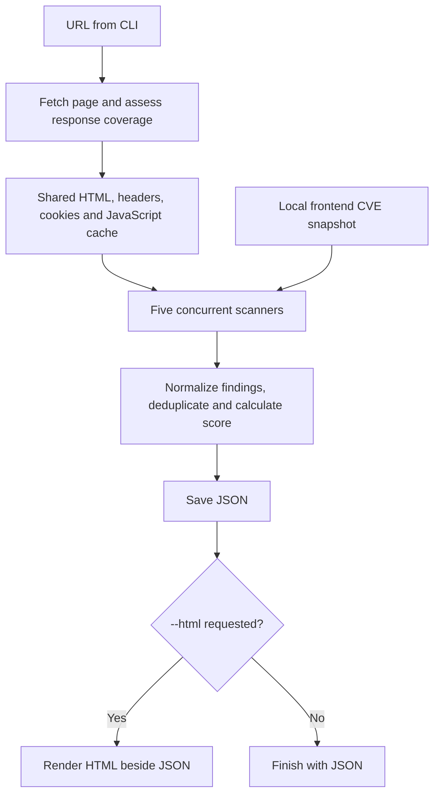

# GP-27-FCDS

## A local, evidence-oriented website security scanner

GP-27-FCDS is our graduation-project workspace. Semester 1 delivers a Python command-line tool that accepts a website URL, runs five focused checks, and saves structured findings as JSON. An optional HTML report makes the same scan easier to inspect and discuss with the team.

The project asks a practical question: **how can we turn externally observable website behavior into understandable, repeatable security findings while showing what we could—and could not—observe?**

[Start with Semester 1](semester-1-project/README.md) · [Run the code](semester-1-project/code/README.md) · [Published results](semester-1-project/results/README.md) · [Related research](semester-1-project/papers/README.md) · [Validation](semester-1-project/validation/README.md)

## The problem we are addressing

A website exposes several kinds of evidence: JavaScript delivered to visitors, library identifiers, response cookies, security-policy headers and responses to cross-origin requests. Looking at these separately makes findings harder to reproduce, compare and explain.

Our first milestone brings five complementary checks into one small local pipeline. Each finding should retain an observation, a location, an interpretation and suggested remediation. Execution failures must remain visible instead of turning into an apparently clean result. The research motivation for these categories is documented in the [papers guide](semester-1-project/papers/README.md); it is separate from evidence that our implementation is correct.

## Why these five checks?

This is the rationale for the Semester 1 scope, not a claim that these are the five most important risks for every website.

| Check | Why it belongs in this milestone | What it examines | Important boundary |
| --- | --- | --- | --- |
| Secrets | Exposed frontend content is a concrete place to investigate accidental credential disclosure. | Key patterns, context and related content in HTML/JavaScript. | A pattern match does not prove an active credential. |
| Frontend Libraries | Component identification connects visible code to known affected-version ranges. | Fingerprints, versions and a bundled CVE CSV. | A matching version is not proof of exploitability in the application. |
| Cookies | Response cookies provide inspectable session/configuration signals. | Attributes and heuristic cookie sensitivity. | No login automation; cookie-free responses do not establish session security. |
| Security Headers | Browser-facing policies provide a manageable set of configuration checks. | CSP, HSTS, framing and other policy/hardening signals. | Header inspection does not reproduce every browser enforcement rule. |
| CORS | Cross-origin responses expose server trust-policy choices. | Origin probes and response policy headers. | HTTP probes do not demonstrate an authenticated browser exploit. |

The five share HTTP content and can reuse a common session/cache. They also admit controlled positive, negative and failure fixtures, making them a practical scope for a semester project. Broader checks, cloud infrastructure and a full web interface are outside this milestone.

## How it works



`main_scanner.py` loads an explicit list of five modules, applies timeouts, and records incomplete checks. The report consumes the result; it does not perform a second scan. No cloud account, API gateway or database server is needed. Scanning still requires network access to the target and its assets.

## Try it

From the repository root, with Python 3.10 or newer:

```bash
cd semester-1-project
python3 -m venv .venv
source .venv/bin/activate
python -m pip install -r code/requirements.txt
python code/main_scanner.py --url "https://example.com"
python code/main_scanner.py --url "https://example.com" --html
```

Windows activation and all options are in the [code guide](semester-1-project/code/README.md). Results default to `semester-1-project/results/`; use `--output results/example.json` for a chosen name. Download a published HTML artifact and open it locally—GitHub's file viewer is not a hosted report page.

## What is delivered today?

| Deliverable | Status |
| --- | --- |
| Five scanners and local orchestrator | Implemented; original extracted detector files preserved |
| Frontend CVE dataset | Bundled static snapshot; no automatic updates |
| JSON export and optional HTML | Implemented |
| Per-folder technical documentation | Available |
| Six integration tests | Recorded passing run with source/data fingerprints |
| Existing scan examples | Two JSON executions and one matching HTML report published |
| Research background | Five selected historical papers plus specifications, with scope comparisons |
| Detector ground-truth benchmark | Designed in documentation; not yet implemented or executed |

The current contribution is an integrated, inspectable teaching/research prototype and a documented workflow. We do not claim a new detection algorithm, superiority over established tools, or measured real-world accuracy. The scanner code originated in the owner's larger Bravo6 project; GP-27-FCDS is the separate local graduation-project version, with no dependency on that repository at runtime.

## Evidence before conclusions

Read completion status and coverage before the score. Six passing integration tests establish specific asserted behaviors, not that all findings are correct. Published site scans show the tool's outputs; they are not ground truth. The [validation guide](semester-1-project/validation/README.md) separates existing evidence from the planned per-rule benchmark, including false-positive/false-negative accounting.

The next research milestone is to label controlled positive and negative cases independently, run the real five modules, and publish per-module coverage and confusion matrices. Literature informs this design but does not validate our implementation automatically.

## Suggested project-series / presentation structure

1. **Problem and scope:** what can be observed from a URL, and why these five checks.
2. **Prior work:** what secret, dependency, cookie, CSP and CORS research studied.
3. **System design:** shared context, concurrent modules, structured evidence and incomplete-state handling.
4. **Demonstration:** one command, the resulting JSON and optional HTML.
5. **Validation:** current test evidence, proposed ground truth and measurement rules.
6. **Limitations and next steps:** coverage, dataset freshness and remaining empirical evaluation.

This order keeps implementation progress and research claims distinct. The detailed [Semester 1 guide](semester-1-project/README.md) links every component; the [papers guide](semester-1-project/papers/README.md) supplies traceable references for future slides and writing.
