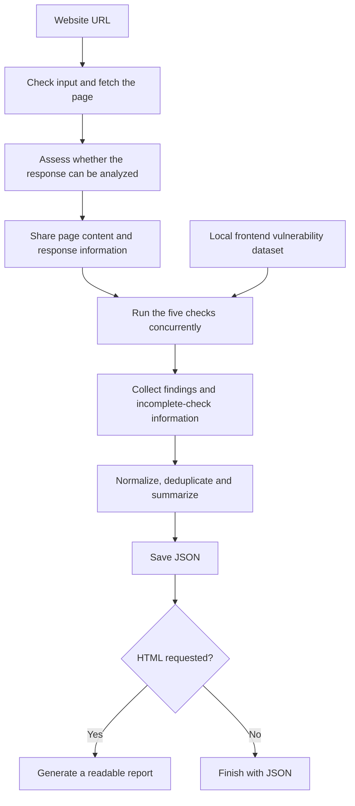

# Semester 1 — Understanding Our Website Security Scanner

## 1. Project idea

Our Semester 1 prototype turns a website URL into a structured security assessment covering five areas: exposed secrets, frontend libraries, cookies, security headers and CORS. It runs locally, saves a JSON result and can produce an HTML report for discussion and review.

The objective is to make observable security signals easier to collect, explain and revisit. A useful finding should tell the reader **what was observed, where it was found, why it matters and what to review or improve**. The system also needs to explain when it could not complete a check.

This guide explains the ideas and engineering decisions behind the working prototype. Installation commands, individual functions and field definitions live in the linked folder guides.

## 2. Why these five checks?

The five checks examine different aspects of the same website through HTTP responses and delivered frontend content. They can share observations while answering distinct questions.

| Area | Question we ask | Value to a reviewer |
| --- | --- | --- |
| Secrets | Does the delivered content contain values that resemble credentials? | Locate potential accidental disclosure and inspect its context. |
| Frontend Libraries | Which supported libraries and versions can we identify, and do they match known affected ranges? | Identify components that may need review or updates. |
| Cookies | What attributes do observed cookies use, and what does their apparent purpose suggest? | Review session-related and other cookie configuration. |
| Security Headers | What browser-facing policies does the response declare? | Identify missing, weak or inconsistent configuration signals. |
| CORS | How does the endpoint respond to a request carrying an unrelated origin? | Examine cross-origin trust-policy behavior. |

This is a manageable first-semester scope: one input, five complementary checks and a common output. It does not cover every vulnerability class, authenticated user journey or page in an application.

## 3. The scan journey

A blocked or unsuitable response is not treated as a clean website. Depending on where the problem occurs, the scan can stop before the checks or record individual checks as incomplete. Output preserves that distinction so the reader can assess coverage before interpreting findings.

## 4. The main orchestrator: one coordinated workflow

The orchestrator is the coordinator, not a sixth vulnerability detector. It gives the five checks a common starting point and brings their results together.

| Responsibility | Mechanism in plain language | Why it matters |
| --- | --- | --- |
| Select the scope | Load an explicit list of five modules. | The expected scan scope remains clear. Adding an unrelated file does not silently enable a new check. |
| Prepare shared observations | Fetch the page and retain HTML, headers and cookie headers. | Different checks can examine the same response. |
| Run work concurrently | Allow the five checks to progress together. | Network waits can overlap instead of forcing every check to wait for the previous one. |
| Bound waiting | Apply request and per-module time limits; retry selected transient initial-fetch failures. | A slow resource should not keep a scan waiting indefinitely. |
| Contain failures | Collect module errors and timeouts alongside completed outputs. | One failed check does not automatically discard the other checks' findings. |
| Standardize results | Convert collected findings into a common structure. | Reviewers can compare evidence across checks. |
| Save and present | Save JSON before requesting optional HTML generation. | A report-generation error does not erase the structured scan result. |

Concurrency is an engineering choice, not a measured speedup claim. We have not published a performance comparison against sequential execution.

## 5. Shared caching: reuse observations within a scan

### The main-page cache

The normal starting point is one successful page fetch. The orchestrator holds the HTML, response headers and all observed `Set-Cookie` header values in memory. Secrets, Frontend Libraries, Cookies and Security Headers can use this shared response instead of independently downloading the same page for their basic analysis. Transient fetch failures can cause retries, so “shared fetch” does not mean exactly one network attempt in every run.

### The JavaScript cache

Secrets and Frontend Libraries may both need the same JavaScript file. If the file has already been downloaded successfully through the shared fetcher, its contents are reused. If another check is currently downloading it, the second check waits for that download and reuses the result when it succeeds.

**Example:** the page references `app.js`. The secrets check inspects it for credential-like content while the library check looks for component fingerprints. They can analyze one downloaded copy for two different purposes.

This design avoids repeated successful downloads through the shared path, reduces unnecessary requests and keeps the shared observation consistent. If a download fails, later attempts may still occur; the cache does not guarantee one request per URL under every failure condition.

### What the cache does not do

- It does not replace a new scan with an old JSON result.
- It does not persist between scan runs; each run starts with a fresh in-memory context.
- It does not eliminate requests needed for distinct evidence. CORS needs its own origin probe; referenced configuration files may need separate requests.
- It does not execute JavaScript or recreate the browser's dynamic state.

The frontend CVE CSV serves a different purpose: it is a persistent local reference dataset. It is not the temporary page/JavaScript cache, and it is not refreshed automatically during a scan.

## 6. What makes each check more than a simple lookup?

Here, “smart” means **explicit rules that combine evidence and context**. These modules are not machine-learning models, and additional rules do not by themselves establish accuracy.

### 6.1 Secrets — patterns, context and controlled disclosure

**Purpose:** find candidate secrets in selected delivered scripts and referenced configuration content.

The detector goes beyond searching for the word “password”:

- **Recognizable formats:** it checks supported credential-shaped patterns.
- **Context for generic candidates:** generic values need nearby credential-style assignment context and sufficient character variation. A random-looking value alone is not enough for that path.
- **Noise filters:** it excludes recognized placeholders, repetitive dummy values and certain comment matches. These filters are heuristics; they can also omit relevant cases.
- **Multiple content forms:** it examines inline and selected external scripts, plus configuration resources referenced by the page. It also inspects strings recovered from simple Base64/hex/Unicode encodings without running the JavaScript.
- **Related evidence:** it can correlate a nearby AWS access-key identifier and secret-key candidate instead of treating them only as unrelated strings.
- **Reviewable output:** findings include location, supporting context and suggested remediation. Recognized secret values are masked in the detector's evidence/context handling.

**Why this matters:** combining shape, context and filtering aims to reduce obvious noise and makes the result easier to investigate. That aim is not a measured false-positive rate.

**Boundary:** live credential verification is not enabled by this CLI. A static match does not establish that a credential exists, remains active or grants access. Selected resources are limited and some hosts are filtered; this is not an exhaustive content crawl. Masking recognized patterns is not a guarantee that every sensitive value anywhere in an output is removed.

### 6.2 Frontend Libraries — identify, cross-check, then correlate

**Purpose:** connect observable frontend components with the local vulnerability dataset.

The check combines several sources of evidence: script URLs, filenames, CDN patterns, version-bearing content and library fingerprints. It prioritizes candidate observations, applies built-in version plausibility checks, and matches a detected version against an affected **range**, rather than requiring exact equality with one stored version.

Where the dataset supplies a signature, the scanner looks for supporting content. A version-banner fallback helps recognize some minified library builds when an assignment-style signature is absent. Rows without a signature can rely on the version claim, so corroboration is not equally strong for every row.

**Why this matters:** a filename, a content fingerprint and a confirmed version carry different evidential weight. Unknown or implausible versions can be reported as informational observations instead of automatically becoming CVE findings.

**Boundary:** the dataset is a static snapshot; supported fingerprints and built-in version assumptions are limited. The implementation selects a preferred candidate within a library group, not an exhaustive inventory of every simultaneously loaded version. A version match does not prove that a vulnerable function is reachable. Some inherited confidence labels say `verified-live` for signature-based matches; that label does not mean an exploit was performed.

### 6.3 Cookies — assess each cookie in context

**Purpose:** inspect the cookies actually present in the shared response.

The check preserves separate cookie headers and assesses cookies individually. It uses names to classify them heuristically as sensitive/session-like, tracking or generic, then adjusts the importance of certain findings accordingly.

It examines attributes such as `HttpOnly`, `Secure` and `SameSite`, checks selected prefix requirements and combinations, and flags unusually long lifetimes for session-like cookies. Transport context influences some checks. Tracking-cookie findings are assigned to the hardening tier rather than automatically treated like authentication-cookie issues.

**Why this matters:** the same missing attribute need not have the same significance for every cookie.

**Boundary:** the name-based classification is not proof of a cookie's real purpose. The prototype does not log in or discover every authentication cookie. “No cookies observed” is an observation about this response, not evidence that the application has secure session handling.

### 6.4 Security Headers — inspect policy and applicability

**Purpose:** review the browser-facing configuration declared by the response.

The check examines selected aspects of CSP, HSTS, framing protection, content-type handling, referrer policy, cache behavior and other headers. It uses clues from the HTML and headers to adjust certain checks for context, such as API-like responses or sensitive-looking pages. Selected baseline policy findings and additional hardening suggestions are distinguished.

**Why this matters:** this is more informative than a checklist that treats every missing header as equally serious on every page. Presence alone is also insufficient; selected policy values and combinations are inspected.

**Boundary:** page categorization is heuristic. The module does not reproduce the full browser policy engine, exercise every CSP bypass or prove that a page is protected against all attacks. Static policy observations support review; they are not comprehensive exploit tests.

### 6.5 CORS — observe a response to an origin probe

**Purpose:** inspect the endpoint's response to a synthetic unrelated origin.

The check performs an OPTIONS probe and can fall back to GET when the OPTIONS path fails or is unsupported. It distinguishes several observations: no CORS header, wildcard policy, reflection of the probe origin, credential-related headers, and a different fixed origin that does not grant access to the probe. Probe failure produces an inconclusive observation rather than a claim that the policy is safe.

**Why this matters:** probing a specific behavior provides evidence beyond merely noticing that a CORS header exists.

**Boundary:** one synthetic origin does not establish how every origin is handled. No authenticated browser exploit is demonstrated. A wildcard-plus-credentials combination is not proof that a compliant browser will expose credentialed responses; the existing finding's severity is a rule-based classification. An inconclusive CORS observation can appear inside a technically completed module, so readers must inspect findings as well as completion counts. The [research guide](papers/README.md) links the relevant specification and discusses this distinction.

## 7. From five outputs to one understandable result

Each detector has its own observations, but the combined findings follow a shared structure: title, producing module, severity, confidence, location, evidence and remediation, with classification information when available.

The orchestrator removes matching duplicates within the same module using the finding identity and location. When candidates overlap under that rule, stronger confidence takes precedence, followed by severity. This is a defined grouping rule, not a claim that all semantically identical issues are merged. Different modules' findings remain distinct.

The JSON preserves both the combined findings and the per-check results. The HTML uses the raw per-check findings for its sections, while its headline count comes from the combined result. Section counts therefore need not sum to the deduplicated total.

**Severity and confidence answer different questions:** severity is the detector's assessment of potential importance; confidence describes the implementation's evidence category. Neither is a calibrated probability that an exploitable vulnerability exists.

## 8. Reliability, security-conscious design and best practices

| Implemented practice | Benefit | Practical limit |
| --- | --- | --- |
| Explicit five-check scope | Predictable execution and a clear feature boundary. | Five checks cannot cover all website security. |
| Shared response/cache | Reuses observations and avoids some duplicate work. | It is not a browser cache or persistent scan history. |
| Timeouts and error collection | Keeps slow or failed checks visible. | A completed routine may still contain inconclusive observations. |
| Response suitability checks | Avoids treating some error/challenge pages as ordinary application content. | WAF/page classification is heuristic. |
| Public-address checks, including connection/redirect handling | Blocks private/internal targets by default. | The local test suite uses an explicit fixture-only override. |
| Recognized-secret masking | Reduces exposure of matched secret values in findings. | It is not a universal output sanitizer. |
| Escaped HTML output | Displays target-controlled text as text in the report. | The integration test checks selected escaping cases, not a full browser security audit. |
| JSON before optional HTML | Preserves the structured result if reporting fails. | A filesystem write failure can still prevent output creation. |
| Local dataset and minimal runtime dependencies | Makes the project easier to run without service credentials. | Dataset freshness and dependency versions still need management. |

The aim is controlled behavior and understandable evidence. These practices are useful engineering properties, not a certification that the prototype is free of defects.

## 9. Scores help summarize; coverage comes first

The prototype computes a rule-based score from finding severity. Additional hardening deductions have a cap so they do not alone dominate the score. The visible score, letter grade and underlying raw score are saved with the results.

Coverage information accompanies the grade: how many modules completed, whether the response was representative and what errors occurred. If coverage is incomplete, the grade is marked unreliable under that execution rule.

A score is a summary for review—not an accuracy measurement, a probability of compromise or a guarantee of safety. Even a coverage-complete scan can contain incorrect or inconclusive findings. The [results guide](results/README.md) explains the exact fields and calculation.

## 10. How we checked the prototype before relying on website output

### Controlled local validation

We created a small local test page with content and response behavior that we chose in advance. It includes a recognizable jQuery 3.3.1 marker, a cookie and a defined CORS response. A second response path returns HTTP 403. The integration suite runs the real orchestrator and modules against this fixture.

| What we exercised | What the assertion establishes |
| --- | --- |
| Five-module execution and local library data | Exactly the selected five modules complete; the frontend check emits a CVE-related finding using the local path. |
| JSON-only output | A normal run creates JSON without HTML. |
| Optional HTML | The requested report and JSON both exist; the five expected sections are present. |
| Blocked page | A 403 response is recorded as incomplete rather than a clean scan. |
| Output location and report failure | Default paths remain project-relative; JSON works without the renderer and remains saved if HTML generation fails. |
| Unsafe-looking report text and invalid output argument | Target markup is escaped, unrelated modules are excluded from rendering, and a non-JSON output filename is rejected. |

These behaviors are covered by **six recorded passing integration tests**. See the [test guide](code/tests/README.md), [run log](validation/current-tests.txt) and [tested-file fingerprints](validation/current-tests-metadata.json).

Here, “validation” means checking selected behavior against known inputs and expectations. It does not mean that the entire vulnerability dataset has been independently audited, that every detector rule has been assessed, or that we measured a detection accuracy percentage. The jQuery assertion confirms that a CVE finding exists; it does not independently verify every possible CVE for that version.

### Application to a real website

The published examples contain two JSON executions for `auic.alexu.edu.eg` and one HTML report paired with the second execution. Each JSON records five completed modules, 15 combined findings and zero orchestrator errors. The original outputs are available in the [published-results guide](results/README.md#published-scan-artifacts).

This demonstrates an end-to-end run on an external website and provides material for explaining the output. It does **not** establish that all 15 findings are genuine exploitable vulnerabilities. In particular, static secret-pattern detections have not been shown to represent active credentials. The two executions are not an independent accuracy study.

## 11. What supports the quality of our work?

The answer is a combination of inspectable mechanisms and bounded evidence:

- **Explainable rules:** each module exposes the observations and reasoning behind its findings.
- **Coordinated engineering:** shared context, caching, concurrent execution and explicit error handling connect the modules into one workflow.
- **Repeatable checks:** recorded tests exercise specific behavior against a controlled fixture.
- **Working outputs:** saved website runs demonstrate that the pipeline can produce JSON and HTML outside the fixture.
- **Traceable background:** the [papers guide](papers/README.md) explains the research motivation and relevant specifications without borrowing their performance claims.

Those points support describing this as a working, documented prototype. They do not justify saying “all detectors are accurate” or “we achieved 100% detection accuracy.” The useful distinction is between **a rule we implemented**, **a behavior we tested**, and **a security conclusion still requiring review**.

## 12. Current deliverables and boundaries

**Implemented:** five local scanners; one orchestrator; shared page and JavaScript caching; local frontend CVE lookup; structured findings and scoring; incomplete-state handling; JSON export; optional HTML; six integration tests; published scan examples; component documentation and related reading.

**Outside the current scope:** browser JavaScript execution, login automation, exhaustive site crawling, automatic CVE refresh, a web dashboard, cloud deployment, and proof of exploitability for every finding. No measured detector-accuracy percentage is claimed.

This scope keeps Semester 1 focused on an understandable working pipeline. A demonstration should show the evidence and failure states as clearly as the successful path.

## 13. Folder guide

| Folder | What to read there |
| --- | --- |
| [code](code/README.md) | Setup, execution commands, module responsibilities and developer workflow. |
| [code/data](code/data/README.md) | What the local frontend dataset contains and how to interpret it. |
| [code/tests](code/tests/README.md) | Exact coverage of the current integration assertions. |
| [report](report/README.md) | Optional HTML generation, functions and artifact fingerprints. |
| [results](results/README.md) | JSON interpretation and the published example files. |
| [validation](validation/README.md) | Supporting validation notes and recorded execution evidence; proposed work is labeled separately. |
| [papers](papers/README.md) | Selected historical research, specifications and scope comparisons. |

## 14. A presentation-ready storyline

1. **The problem:** useful website security observations are spread across content, dependencies and response policies.
2. **Our scope:** five complementary checks with one URL as input.
3. **The coordinator:** the orchestrator prepares shared context and manages execution and failures.
4. **The efficiency idea:** page and JavaScript caching reuse observations within a run.
5. **The detection ideas:** explain the context and evidence used by each module, starting with Secrets.
6. **The output:** structured findings, prioritization and optional readable reporting.
7. **The evidence:** controlled local tests followed by published website execution examples.
8. **The conclusion:** a working, inspectable prototype with clearly stated coverage and interpretation limits.

**Project summary:** Semester 1 delivers a local website-security prototype that coordinates five evidence-producing checks, shares fetched content, records incomplete observations and produces JSON with optional HTML. Its engineering choices and current test evidence are documented so the team can explain how it works without confusing a successful run with proof that every finding is correct.
